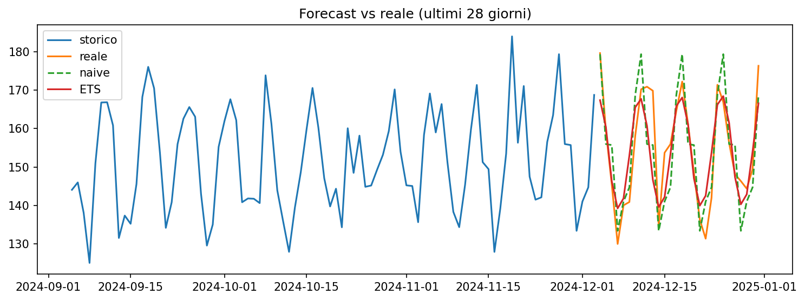

# 💡 lumen-x



> AI-powered sales forecasting for small businesses. ASP.NET Core + FastAPI + LLM.

*Lumen-X: the future, in plain sight.*

**Lumen-X** is a sales forecasting system with an AI assistant that explains the numbers in plain language. Built for small businesses: shops, restaurants and small e-commerce stores.

Upload your sales data, get reliable forecasts, and ask questions like:

- *"How much should I reorder next week?"*
- *"Why are March sales below forecast?"*
- *"Which products are at risk of stocking out?"*

## Why I built this

I'm a .NET developer with about two years of professional experience, and I got hooked on AI. I wanted to learn by building something real: a project that combines classical forecasting with LLMs, written with the stack I know and the one I want to learn.

Small businesses have the data but not a data team. Lumen-X aims to close that gap: solid models under the hood, clear answers on the surface.

## How it works

```
CSV / API  →  .NET Backend  →  Forecasting service (Python)
                  │                        │
                  ▼                        ▼
              PostgreSQL            Statistical / ML models
                  │
                  ▼
           LLM layer (explanations and data Q&A)
                  │
                  ▼
              Dashboard
```

| Component | Technology |
|---|---|
| Backend and API | C# / ASP.NET Core |
| Forecasting | Python, FastAPI, statsmodels, LightGBM |
| AI layer | LLM via API |
| Database | PostgreSQL |
| Frontend | Blazor |
| Deployment | Docker Compose |

## Features

- [ ] Sales data import from CSV
- [ ] Baseline models and time-aware backtesting
- [ ] Forecasts by product and time period
- [ ] Natural-language explanations of forecasts
- [ ] Chat-based questions over your data
- [ ] Reorder suggestions (safety stock)
- [ ] Interactive dashboard

## Model evaluation

Models are compared against a naive baseline using rolling-window backtesting, with no data leakage. Metrics: MAPE, RMSE, MASE. Results and experiments live in [`/notebooks`](./notebooks).

## Quick start

> 🚧 Coming soon: the `docker-compose.yml` will be available with the first version of the backend.

```bash
git clone https://github.com/<asciosh>/lumen-x.git
cd lumen-x
docker compose up
```

## Roadmap

1. **Notebook** with EDA, baselines and backtesting
2. **Forecasting service** exposing a `/forecast` endpoint
3. **.NET backend** and persistence
4. **LLM layer** for explanations and data Q&A
5. **Dashboard**, deployment and a trial with real data

## Project status

🚧 Work in progress. A side project built to learn and experiment with forecasting and applied AI, with the goal of making it production-ready.

## License

[MIT](./LICENSE)
