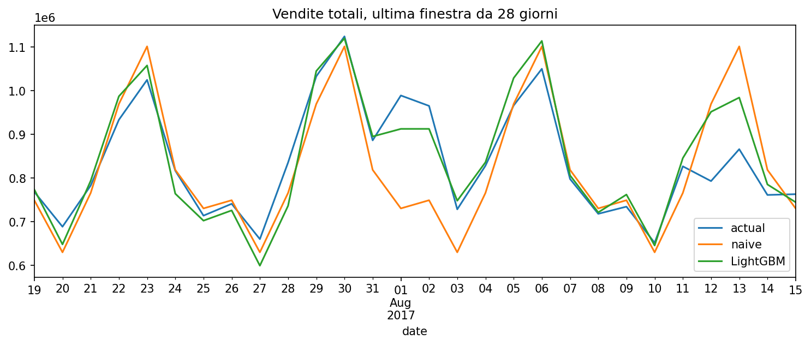
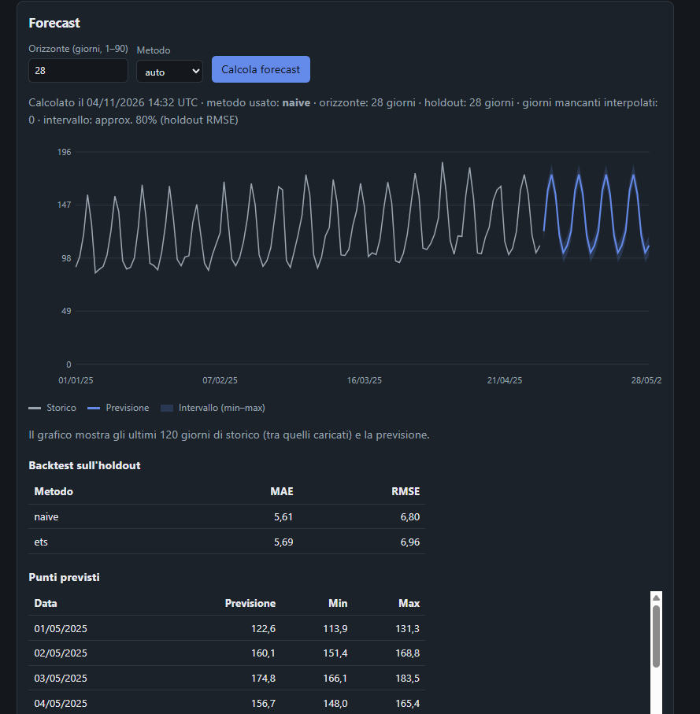
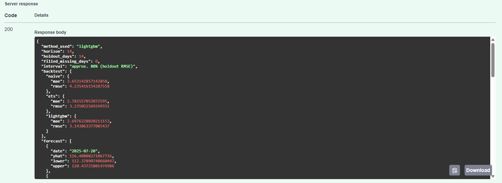
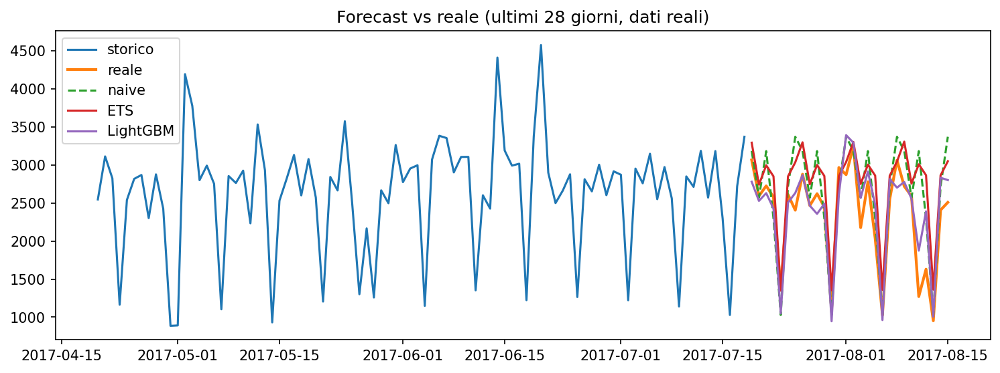

# 💡 lumen-x

> AI-powered sales forecasting for small businesses. ASP.NET Core + FastAPI + LLM.



*Lumen-X: the future, in plain sight.*

**Lumen-X** is a sales forecasting system with an AI assistant that explains the numbers in plain language. Built for small businesses: shops, restaurants and small e-commerce stores.

Upload your sales data, get reliable forecasts, and ask questions like:

- *"How much should I reorder next week?"*
- *"Why are March sales below forecast?"*
- *"Which products are at risk of stocking out?"*

## Why I built this

I'm a .NET developer with about two years of professional experience, and I got hooked on AI. I wanted to learn by building something real: a project that combines classical forecasting with LLMs, written with the stack I know and the one I want to learn.

Small businesses have the data but not a data team. Lumen-X aims to close that gap: solid models under the hood, clear answers on the surface.

## How it works

```
CSV / API  →  .NET Backend  →  Forecasting service (Python)
                  │                        │
                  ▼                        ▼
              PostgreSQL            Statistical / ML models
                  │
                  ▼
           LLM layer (forecast explanations; data Q&A planned)
                  │
                  ▼
              Dashboard
```

| Component | Technology | Status |
|---|---|---|
| Forecasting service | Python, FastAPI, statsmodels, LightGBM | ✅ available |
| Backend and API | C# / ASP.NET Core | done |
| AI layer | LLM via API | planned |
| Database | PostgreSQL | planned |
| Frontend | Blazor | planned |
| Deployment | Docker Compose | forecasting, backend, dashboard, PostgreSQL |

Dashboard (Blazor Server): products, CSV import and forecasts with chart.



Live demo (example data): https://asciosh.github.io/lumen-x/demo/

## Features

- [x] Baseline models and time-aware backtesting
- [x] Forecasting API (naive, ETS, LightGBM and their blend, used by default)
- [x] Sales data import from CSV
- [x] Forecasts by product and time period
- [x] Natural-language explanations of forecasts
- [ ] Chat-based questions over your data
- [x] Reorder suggestions (safety stock)
- [x] Interactive dashboard

## Forecasting service

A FastAPI service that turns a daily sales history into a forecast. It backtests the available models on a holdout, picks the best one and returns the forecast with an approximate 80% interval.



Full documentation: [`services/forecasting`](./services/forecasting).

## Model evaluation

Models are compared against a seasonal naive baseline using expanding-window backtesting with a 28-day horizon, with no data leakage (lags and rolling features only use data at least 28 days old).

**Global LightGBM** (Kaggle Store Sales, all 54 stores x 33 product families, 3 backtest windows):

| model | WAPE | RMSLE |
|:--|--:|--:|
| seasonal naive | 17.1 | 0.550 |
| LightGBM (global) | 13.5 | 0.413 |

The global model beats the baseline in every window, cutting WAPE by about 21% and RMSLE by about 25%.

**Single series** (store 1, GROCERY I): LightGBM (MAPE 19.3) and ETS (20.4) are close, both ahead of the naive baseline (21.9). Learning across series is what makes the difference.

**Limitations:** only 3 recent backtest windows, no hyperparameter tuning, no external features (oil, transactions, local holidays).



## Run the notebooks

Open them in Google Colab. The Kaggle data needs a free Kaggle account and an API token saved in Colab Secrets as `KAGGLE_API_TOKEN`.

| Notebook | |
|:--|:--|
| 01 · Synthetic data baseline | [](https://colab.research.google.com/github/asciosh/lumen-x/blob/main/notebooks/01_eda_baseline.ipynb) |
| 02 · Real data, single series | [](https://colab.research.google.com/github/asciosh/lumen-x/blob/main/notebooks/02_real_data_lightgbm.ipynb) |
| 03 · Global model | [](https://colab.research.google.com/github/asciosh/lumen-x/blob/main/notebooks/03_global_lightgbm.ipynb) |

## Quick start

Starts the forecasting service on http://localhost:8000 (interactive docs at `/docs`).

```bash
git clone https://github.com/asciosh/lumen-x.git
cd lumen-x
docker compose up --build
Then open the dashboard on http://localhost:8081 (in a Codespace: Ports tab, port 8081).
```

## Roadmap

- [x] **Notebooks**: EDA, baselines, single-series and global LightGBM models with backtesting
- [x] **Forecasting service** exposing a `/forecast` endpoint (FastAPI)
- [x] **.NET backend** and persistence
- [x] **LLM layer** for forecast explanations (Italian/English, Gemini optional)
- [x] **Dashboard** (Blazor Server)
- [ ] Deployment and a trial with real data

## Project status

🚧 Work in progress. A side project built to learn and experiment with forecasting and applied AI, with the goal of making it production-ready.

## License

[MIT](./LICENSE)
