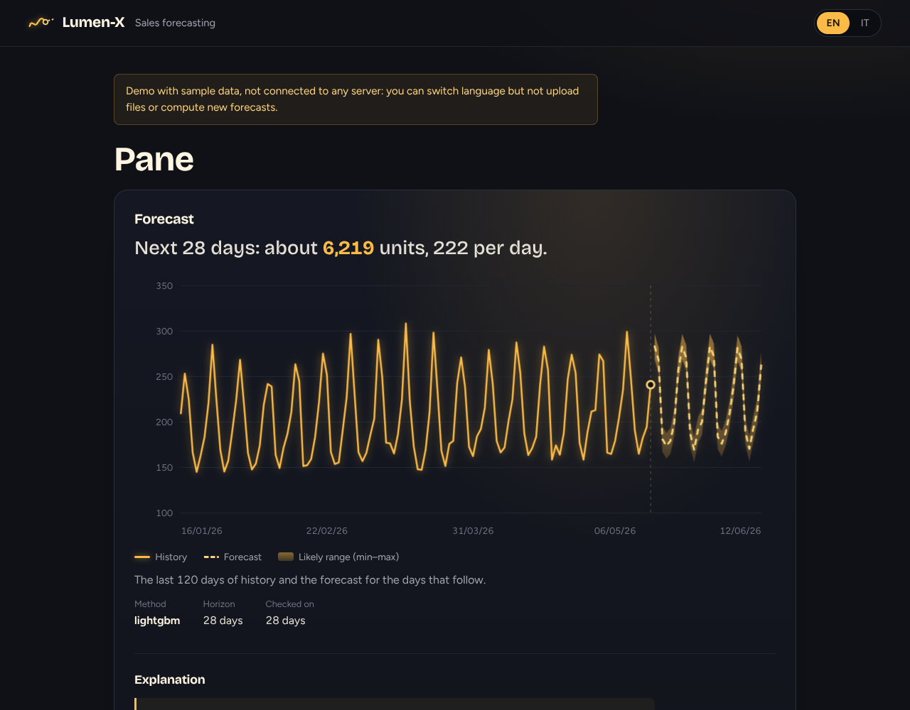

# 💡 lumen-x

> AI-powered sales forecasting for small businesses. ASP.NET Core + FastAPI + LLM.


[](https://github.com/asciosh/lumen-x/actions/workflows/ci.yml)
[](https://asciosh.github.io/lumen-x/)
[](https://codespaces.new/asciosh/lumen-x)

*Lumen-X: the future, in plain sight.*

**Lumen-X** is a sales forecasting system with an AI assistant that explains the numbers in plain language. Built for small businesses: shops, restaurants and small e-commerce stores.

Upload your sales data, get forecasts with honest error estimates, and ask questions like:

- *"How much did I sell in the last 30 days?"*
- *"What should I order?"*
- *"How reliable is the forecast?"*

## Why I built this

I'm a .NET developer with about two years of professional experience, and I got hooked on AI. I wanted to learn by building something real: a project that combines classical forecasting with LLMs, written with the stack I know and the one I want to learn.

Small businesses have the data but not a data team. Lumen-X aims to close that gap: solid models under the hood, clear answers on the surface.

## How it works

```
CSV / API  →  .NET Backend  →  Forecasting service (Python)
                  │                        │
                  ▼                        ▼
              PostgreSQL            Statistical / ML models
                  │
                  ▼
           LLM layer (forecast explanations) and rule-based data Q&A
                  │
                  ▼
              Dashboard
```

| Component | Technology | Status |
|---|---|---|
| Forecasting service | Python, FastAPI, statsmodels, LightGBM | ✅ available |
| Backend and API | C# / ASP.NET Core | ✅ available |
| AI layer | Gemini API (optional), rule-based fallback | ✅ available |
| Database | PostgreSQL | ✅ available |
| Dashboard | Blazor Server | ✅ available |
| Deployment | Docker Compose | forecasting, backend, dashboard, PostgreSQL |

Dashboard (Blazor Server, English and Italian): products, CSV import, forecasts with chart, explanations, reorder suggestions and questions about your data.



**Live demo** (real outputs of the app on example data, English and Italian): <https://asciosh.github.io/lumen-x/>

**Try the real app**, with nothing to install: click *Open in GitHub Codespaces* above. The first start takes a few minutes (it builds the containers and loads sample data); then the dashboard opens by itself. It uses your own free Codespaces allowance and nothing is public.

## Features

- [x] Baseline models and time-aware backtesting
- [x] Forecasting API (naive, ETS, LightGBM and their blend, used by default)
- [x] Sales data import from CSV
- [x] Forecasts by product and time period
- [x] Natural-language explanations of forecasts
- [x] Questions over your data (rule-based, no AI needed)
- [x] Reorder suggestions (safety stock)
- [x] Interactive dashboard, bilingual (English / Italian)

## Forecasting service

A FastAPI service that turns a daily sales history into a forecast. By default it averages two models (ETS and LightGBM) when there is enough history, otherwise it picks the better of naive and ETS on a backtest, and returns the forecast with an approximate 80% interval.


Full documentation: [`services/forecasting`](./services/forecasting).

## Model evaluation

Models are compared against a seasonal naive baseline using expanding-window backtesting with a 28-day horizon, with no data leakage (lags and rolling features only use data at least 28 days old).

**Global LightGBM** (Kaggle Store Sales, all 54 stores x 33 product families, 3 backtest windows):

| model | WAPE | RMSLE |
|:--|--:|--:|
| seasonal naive | 17.1 | 0.550 |
| LightGBM (global) | 13.5 | 0.413 |

The global model beats the baseline in every window, cutting WAPE by about 21% and RMSLE by about 25%.

**Single series** (store 1, GROCERY I): LightGBM (MAPE 19.3) and ETS (20.4) are close, both ahead of the naive baseline (21.9). Learning across series is what makes the difference.

**Limitations:** only 3 recent backtest windows, no hyperparameter tuning, no external features (oil, transactions, local holidays).


## Run the notebooks

Open them in Google Colab. The Kaggle data needs a free Kaggle account and an API token saved in Colab Secrets as `KAGGLE_API_TOKEN`.

| Notebook | |
|:--|:--|
| 01 · Synthetic data baseline | [](https://colab.research.google.com/github/asciosh/lumen-x/blob/main/notebooks/01_eda_baseline.ipynb) |
| 02 · Real data, single series | [](https://colab.research.google.com/github/asciosh/lumen-x/blob/main/notebooks/02_real_data_lightgbm.ipynb) |
| 03 · Global model | [](https://colab.research.google.com/github/asciosh/lumen-x/blob/main/notebooks/03_global_lightgbm.ipynb) |

## Quick start

Starts everything: PostgreSQL, the forecasting service (port 8000), the backend (8080) and the dashboard (8081).

```bash
git clone https://github.com/asciosh/lumen-x.git
cd lumen-x
docker compose up --build
```

Then open the dashboard on http://localhost:8081 (in a Codespace: Ports tab, port 8081). Explanations work without any key; to let Gemini rewrite them, set `GEMINI_API_KEY` (see `backend/README.md`).

In a Codespace the sample data (a product with 240 days of synthetic sales and a forecast) is loaded for you. Elsewhere, after `docker compose up`, run `bash scripts/seed_demo.sh` to load it.

Tests: `pytest` in `services/forecasting`, `dotnet test backend/tests/LumenX.Api.Tests` and `dotnet test dashboard/tests/LumenX.Dashboard.Tests`.
`bash scripts/check_dev.sh` checks that the whole development environment is healthy (add `--tests` to run every suite).

## Cloudflare edition (private beta)

A second implementation in [`cloudflare/`](cloudflare/) runs on the **free** Cloudflare plan, with no credit card: a Worker, a D1 database and a
sign-in with GitHub, so each invited person logs in and sees only his own products. It does the same things as the full stack (CSV upload,
forecast with backtest, plain-language explanations, questions about the data, reorder suggestions, English and Italian) with two
differences: it has no LightGBM (the average of ETS and LightGBM is about 10% better on the Bread series) and no Gemini. It is invite only, so
there is no public address; see [`cloudflare/README.md`](cloudflare/README.md) for how it works, how it was tested and the setup.

## Roadmap

- [x] **Notebooks**: EDA, baselines, single-series and global LightGBM models with backtesting
- [x] **Forecasting service** exposing a `/forecast` endpoint (FastAPI)
- [x] **.NET backend** and persistence
- [x] **LLM layer** for forecast explanations (Italian/English, Gemini optional)
- [x] **Dashboard** (Blazor Server)
- [x] Trial with real data (Kaggle Store Sales, rolling backtest)
- [x] **Cloudflare edition**: free hosting with a login (sign-in with GitHub), the data of each user kept apart; invite-only beta
- [ ] Open to everyone: not yet, on purpose (limits per user, daily question limit and a privacy review come first). For now: the live demo above, a one-click Codespace and the invite-only beta

## Results on real data

Rolling backtest on the Kaggle *Store Sales* dataset: 8 windows of 28 days, error as WAPE (lower is better).

| Series | Seasonal naive | ETS + LightGBM blend (default) |
|---|---|---|
| Bread / bakery | 17.7% | 10.6% |
| School supplies | 68.0% | 57.7% |

Series with many zero-sales days are flagged as unreliable in the explanations and in the reorder suggestions.

## Project status

🚧 Work in progress. A side project built to learn and experiment with forecasting and applied AI, with the goal of making it production-ready.

## License

[MIT](./LICENSE)
